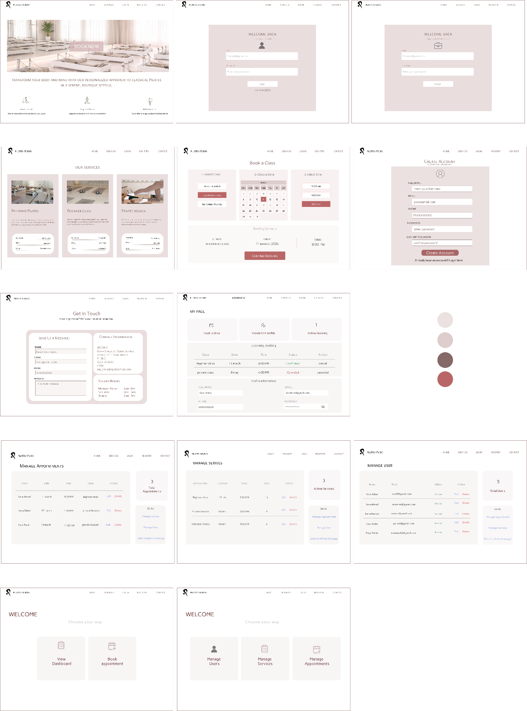
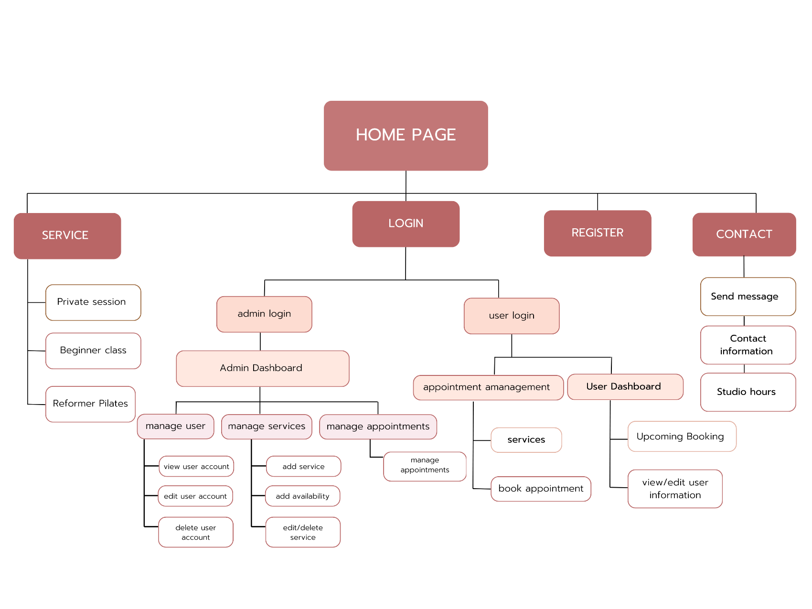

# Pilates Studio Booking Website

A web-based appointment system for a boutique Pilates studio. Clients register, browse classes and book a time slot online. Administrators manage users, services and appointments from their own dashboard.

Built as a team project for **MIS 366: Web-Based Applications** at King Saud University, with ASP.NET Web Forms, C# and SQL Server.

**[View the Figma prototype](https://www.figma.com/proto/Up3bPeMEIMD6JEMROhDD2k/Pilates-Studio?node-id=1-2&p=f&scaling=min-zoom&content-scaling=fixed&page-id=0%3A1&starting-point-node-id=1%3A2)**



## The problem

Small studios often take bookings by phone or messaging apps. This leads to scheduling mistakes, no clear view of availability, and manual work for staff. The goal was a simple online system that handles the booking flow for both clients and staff.

## Features

**For clients**
- Register an account and log in
- Browse the three services: Reformer Pilates, Beginner Class and Private Session
- Book a class in three steps: choose the class, the date and the time
- See a booking confirmation
- View upcoming bookings and profile details on a personal dashboard
- View the studio's contact details and opening hours

**For administrators**
- Separate admin login and dashboard
- View all users, and delete accounts
- View all services, and delete services
- View all appointments, and cancel them

Logins are checked against the database by role (client or admin), and users can log out from any page.

## How it was built

| Phase | What we did | Tools |
|---|---|---|
| 1. Planning | Defined the requirements and drew the site map | Report, diagramming tool |
| 2. Design | Designed every page and a clickable prototype | Figma |
| 3. Development | Built the pages, database, login and booking logic | Visual Studio, ASP.NET Web Forms, C#, HTML, CSS, JavaScript |
| 4. Data | Stored users, services, availability and appointments | SQL Server LocalDB |

### Site map



### Database

Four tables: `Users`, `Services`, `Availability` and `Appointments`. The script in [`database/schema.sql`](database/schema.sql) creates them.

All database queries use parameters, which protects the site against SQL injection.

## Challenges and solutions

| Challenge | Solution |
|---|---|
| Connecting separate pages into one logical flow | Used a shared master page and `Response.Redirect()` in the C# code-behind, with clear comments so the team could follow each other's code |
| Matching the live site to the Figma design | Used precise CSS values for corner radius, custom colours and shadows so the site looked like the approved prototype |
| Booking only valid time slots | Added a server-side check against the `Availability` table before a booking is saved |

## My role

I worked on:
- Front-end development
- Back-end development
- Testing and validation
- Preparing the final presentation

## Running it locally

You need Windows and [Visual Studio](https://visualstudio.microsoft.com/) with the **ASP.NET and web development** workload.

1. Open `src/PilatesStudio.sln` in Visual Studio.
2. In Solution Explorer, right-click the `App_Data` folder and choose **Add → New Item → SQL Server Database**. Name it `AppointmentDB.mdf`.
3. Open the new database in Server Explorer, start a new query, and run `database/schema.sql`.
4. Press **F5** to run the site.

The script adds a demo admin account: `admin@pilates.com` with password `ChangeMe123`.

## Planned improvements

- Store passwords as secure hashes instead of plain text
- Prevent two clients from booking the same slot at the same time
- Let clients cancel bookings and edit their profile
- Let admins add and edit services and availability
- Add form validation and a working contact form
- Restrict admin pages to logged-in admins

## Repository structure

```
pilates-booking-website/
├── README.md
├── src/
│   ├── PilatesStudio.sln            Visual Studio solution
│   └── PilatesStudio/               Pages (.aspx), C# code-behind, CSS, images
├── database/
│   └── schema.sql                   Creates the database tables
└── docs/
    ├── pilates-report-phase1.pdf    Phase 1 report (overview, site map, UI)
    ├── project-presentation.pdf     Final presentation
    ├── site-map.png
    └── ui-screens-figma.png
```

## Team

Team project with Ruyuf Alsayari, Rama Alowlah and Manar Almousa.
